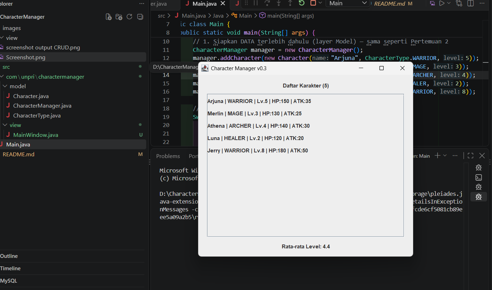

# Character Manager — TP3 (Java Visual SIH-6406)

Character Manager adalah aplikasi Java sederhana untuk membuat dan mengelola karakter game menggunakan konsep pemrograman berorientasi objek. Aplikasi ini memodelkan nama, jenis, level, HP, attack, dan mana karakter, serta menyediakan pemeriksaan status hidup melalui method `isAlive()`.

# Hasil Program terminal

Berikut screenshot hasil eksekusi aplikasi:


# Fitur Analitik Rancangan Sendiri -TP5

Fitur tambahan yang dibuat adalah `renameCharacter(oldName, newName)` pada
`CharacterManager`. Method ini mengganti nama karakter yang sudah terdaftar,
tetapi hanya jika karakter dengan nama lama ditemukan dan nama baru tidak
kosong serta belum digunakan oleh karakter lain. Jika validasi gagal, method
mengembalikan `false` dan data karakter tidak diubah; jika berhasil,
mengembalikan `true`.

Fitur ini berguna untuk memperbarui nama karakter tanpa menghapus lalu membuat
karakter baru, sehingga tipe, level, dan atribut lainnya tetap dipertahankan.
Encapsulation tetap terjaga karena method bekerja langsung pada koleksi internal
`CharacterManager` tanpa mengembalikan atau mengekspos `ArrayList` tersebut.
Pengujiannya di `Main.java` menunjukkan bahwa penggantian nama Merlin menjadi
Arjuna ditolak karena nama Arjuna sudah dipakai, sedangkan penggantian Merlin
menjadi Gandalf berhasil.

# MainWindow v0.4, Data Dinamis & Analisis MVC -TP8

# Screenshot MainWindow

Screenshot berikut menunjukkan tampilan sebelum refactor v0.4; versi saat ini
menampilkan daftar karakter sebagai kartu berwarna dan tidak menampilkan
rata-rata level.



# Aliran Data dan MVC

`Main.java` membuat data karakter melalui `CharacterManager`, lalu mengirim
salinan daftar karakter ke `MainWindow`. View menampilkan setiap karakter
sebagai kartu dengan warna berdasarkan role. Model mengelola data, sedangkan
view bertugas menampilkan data; GUI dijalankan di Event Dispatch Thread
menggunakan `SwingUtilities.invokeLater()`.

# Karakter Tambahan

- Luna — `HEALER`, level 2: dipilih sebagai karakter pendukung dengan level
  lebih rendah agar variasi level terlihat dan memengaruhi rata-rata.
- Jerry — `WARRIOR`, level 8: dipilih sebagai karakter petarung level
  tinggi untuk menambah variasi level dan tipe karakter.


# TP10 — AppTheme, Properti Swing, dan MVC

## Perbandingan tampilan

Sebelum (MainWindow v0.3):


Sesudah (MainWindow v0.4):


Warna disimpan di `AppTheme` karena warna adalah keputusan presentasi, bukan data karakter. Dengan begitu, `Character` tetap bisa dipakai tanpa bergantung pada AWT atau Swing, sementara View dapat mengganti palet tanpa mengubah Model. Arah dependensi tetap satu arah: View membaca `CharacterType` dari Model untuk memilih warna, tetapi Model tidak mengenal View. Pemusatan ini juga mencegah aturan tampilan yang sama tersebar dan berbeda-beda di banyak komponen.

## Hasil run v0.4

Program berhasil menampilkan enam karakter. Level 5 ke atas ditampilkan dengan
teks emas tebal, sedangkan warna kartu mengikuti role masing-masing.

```text
Daftar Karakter (6)
Arjuna     | WARRIOR | Lv.5 | HP:150 | ATK:35
Merlin     | MAGE    | Lv.3 | HP:130 | ATK:25
Athena     | ARCHER  | Lv.4 | HP:140 | ATK:30
Gatotkaca  | WARRIOR | Lv.7 | HP:170 | ATK:45
Morgana    | MAGE    | Lv.1 | HP:110 | ATK:15
Luna       | HEALER  | Lv.2 | HP:120 | ATK:20
```


## Dua properti tambahan

- **Tooltip detail** menampilkan role, HP, dan ATK ketika kartu disorot, sehingga informasi tambahan tersedia tanpa membuat daftar lebih padat.
- **Border sesuai role** mengulang kode warna role pada tepian kartu, sehingga jenis karakter tetap mudah dibedakan dan tampil konsisten.

## Analisis Bagian D

### JavaBeans dan properti Swing

Komponen Swing mengikuti konvensi JavaBeans: nilai properti dibaca melalui getter seperti `getForeground()` dan diubah lewat setter seperti `setForeground(Color)`. Pola ini membuat cara akses properti dapat dikenali IDE, alat inspeksi, dan mekanisme binding. Setter juga memberi komponen kesempatan menjaga perilaku yang terkait dengan perubahan tersebut, misalnya memperbarui nilai properti yang tercatat, memberi tahu listener melalui property-change event, atau meminta tampilan digambar ulang. Karena itu, mengubah field internal secara langsung bukan hanya melanggar enkapsulasi, tetapi juga dapat membuat layar atau listener tetap memakai nilai lama. Memanggil `setForeground()` menyampaikan perubahan melalui antarmuka resmi komponen sehingga perilakunya tetap konsisten.

### Mengapa latar `JLabel` tidak tampak

Pada contoh `JLabel l = new JLabel("HP"); l.setBackground(Color.RED); panel.add(l);`, nilai background sudah merah, tetapi `JLabel` secara default tidak melukis latarnya sendiri karena sifatnya tidak opaque. Supaya warna terlihat, aktifkan `l.setOpaque(true)` setelah `setBackground(Color.RED)`. Alternatifnya, jika yang ingin diberi latar adalah seluruh area, atur background pada `JPanel` yang membungkus label. Properti `opaque` menyatakan bahwa komponen menutupi seluruh area yang ditempatinya dan bertanggung jawab menggambar latar tersebut.

### Ukuran komponen dan layout

`setSize(width, height)` menetapkan ukuran aktual komponen atau jendela; nilainya dapat berubah ketika layout mengatur ulang komponennya. `setPreferredSize(dimension)` menyampaikan ukuran yang diinginkan kepada layout manager, bukan menjamin ukuran itu selalu dipakai. `pack()` menghitung ukuran jendela berdasarkan preferred size komponen dan layout yang digunakan, sehingga umumnya menjadi pilihan tepat setelah seluruh isi UI dipasang. `setBounds(x, y, width, height)` menetapkan posisi dan ukuran sekaligus; cara ini sering dipasangkan dengan null layout. Null layout dihindari karena programmer harus menghitung koordinat sendiri, dan tata letak mudah rusak ketika ukuran jendela, teks, skala tampilan, atau font berbeda. Layout manager lebih adaptif serta menjaga susunan komponen saat ukuran berubah.

### Batas Model dan View dalam MVC

Pemetaan `CharacterType` ke warna adalah keputusan presentasi, sehingga diletakkan di `AppTheme` pada layer View. Model cukup menyimpan fakta domain seperti role dan level; ia tidak perlu mengimpor AWT atau mengetahui bagaimana sebuah karakter digambar. Jika `Character` menyimpan `Color`, Model menjadi bergantung pada teknologi UI: pemakaian ulang untuk aplikasi terminal atau layanan tanpa GUI menjadi lebih sulit, dan pengujian Model memerlukan kelas tampilan. Konsekuensi lain, perubahan tema atau kebutuhan tampilan alternatif dapat memaksa perubahan dan pengujian ulang Model, walaupun aturan bisnisnya tidak berubah. Ketergantungan berbalik seperti itu juga membuat pemisahan tugas dan perawatan proyek lebih rumit. Pada desain ini, View boleh membaca `CharacterType` dari Model lalu memilih warna, tetapi Model tidak mengimpor atau memanggil View.

### Font logis dan `deriveFont()`

Nama font fisik tertentu belum tentu terpasang pada setiap komputer. Jika font tidak tersedia, sistem dapat menggantinya dengan font lain yang mungkin berbeda metrik dan tampilannya. Nama logis seperti `SansSerif` dan `Monospaced` dipetakan Java ke font yang tersedia, sehingga pilihan ini lebih portabel. `deriveFont()` menghasilkan objek font baru dengan ukuran atau gaya turunan, tanpa mengubah objek `Font` asal. Perhatikan tipe argumennya: `deriveFont(20)` memilih overload `deriveFont(int style)`, jadi angka 20 diperlakukan sebagai bit gaya, bukan ukuran 20 poin. Gunakan `deriveFont(20f)` untuk overload ukuran bertipe `float`, atau `deriveFont(Font.BOLD, 20f)` jika sekaligus ingin menetapkan gaya tebal dan ukuran.

# Struktur Folder Project

```text
CharacterManager/
├── README.md
├── images/
│   ├── Screenshot MainWindow.png
│   ├── MainWindow-TP8.png
│   ├── Screenshot MainWindow-TP10.v4.0.png
│   └── screenshot output CRUD.png
└── src/
    ├── Main.java
    └── com/
        └── unpri/
            └── charactermanager/
                ├── model/
                │   ├── Character.java
                │   ├── CharacterManager.java
                │   └── CharacterType.java
                └── view/
                    ├── AppTheme.java
                    └── MainWindow.java
```
# Identitas Mahasiswa 

- Nama Lengkap:JERRY LIM
- NIM:253303621237

- Google Docs — TP3 Bagian D:[Buka dokumen Google Docs](https://docs.google.com/document/d/1QCCENsT26y548l06515b_NNMhOVXbDBsuPcFhBB3kfo/edit?usp=sharing)

- Google Docs — TP5 Bagian D:[Buka dokumen Google Docs](https://docs.google.com/document/d/1U4AAVVxghHRqwvg9p-WrIZhaKMxz98BZm47wv41bs3c/edit?usp=sharing)

- Google Docs — TP8 Bagian D:[Buka dokumen Google Docs](https://docs.google.com/document/d/1lkHuX0GrZKFleA6RWSVx6Ncd8AULnxsUxsS6v9YgOO0/edit?usp=sharing)

- Google Docs — TP10 Bagian D:[Buka dokumen Google Docs](https://docs.google.com/document/d/1BN0ADzrpbspCdLpf3GC0eMQ7rpXkaZK-UzuvVE7buAY/edit?usp=sharing)