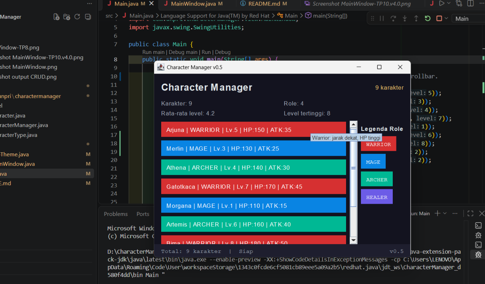
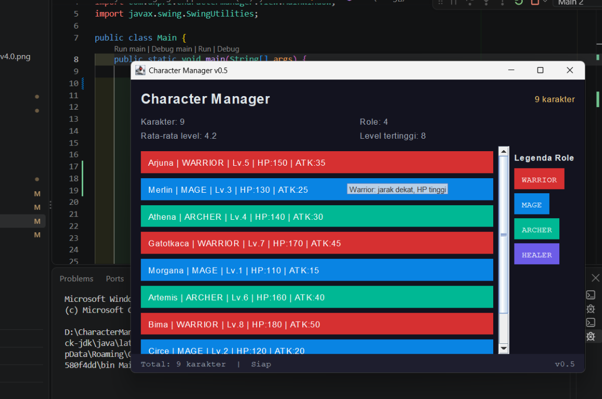
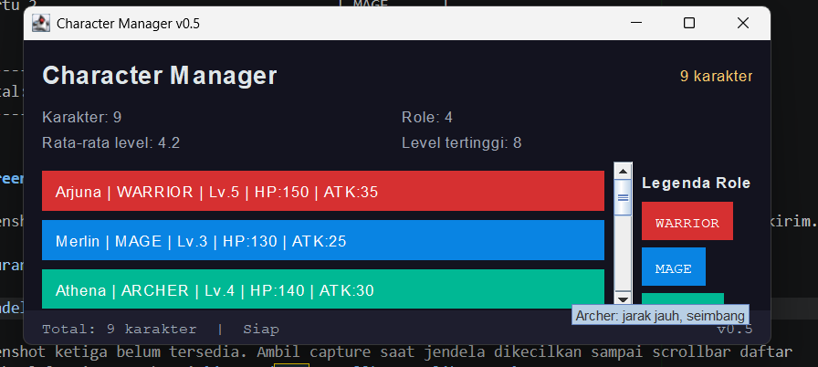

# Character Manager — TP3 (Java Visual SIH-6406)

Character Manager adalah aplikasi Java sederhana untuk membuat dan mengelola karakter game menggunakan konsep pemrograman berorientasi objek. Aplikasi ini memodelkan nama, jenis, level, HP, attack, dan mana karakter, serta menyediakan pemeriksaan status hidup melalui method `isAlive()`.

# Hasil Program terminal

Berikut screenshot hasil eksekusi aplikasi:


# Fitur Analitik Rancangan Sendiri -TP5

Fitur tambahan yang dibuat adalah `renameCharacter(oldName, newName)` pada
`CharacterManager`. Method ini mengganti nama karakter yang sudah terdaftar,
tetapi hanya jika karakter dengan nama lama ditemukan dan nama baru tidak
kosong serta belum digunakan oleh karakter lain. Jika validasi gagal, method
mengembalikan `false` dan data karakter tidak diubah; jika berhasil,
mengembalikan `true`.

Fitur ini berguna untuk memperbarui nama karakter tanpa menghapus lalu membuat
karakter baru, sehingga tipe, level, dan atribut lainnya tetap dipertahankan.
Encapsulation tetap terjaga karena method bekerja langsung pada koleksi internal
`CharacterManager` tanpa mengembalikan atau mengekspos `ArrayList` tersebut.
Pengujiannya di `Main.java` menunjukkan bahwa penggantian nama Merlin menjadi
Arjuna ditolak karena nama Arjuna sudah dipakai, sedangkan penggantian Merlin
menjadi Gandalf berhasil.

# MainWindow v0.4, Data Dinamis & Analisis MVC -TP8

# Screenshot MainWindow

Screenshot berikut menunjukkan tampilan sebelum refactor v0.4; versi saat ini
menampilkan daftar karakter sebagai kartu berwarna dan tidak menampilkan
rata-rata level.


# Aliran Data dan MVC

`Main.java` membuat data karakter melalui `CharacterManager`, lalu mengirim
salinan daftar karakter ke `MainWindow`. View menampilkan setiap karakter
sebagai kartu dengan warna berdasarkan role. Model mengelola data, sedangkan
view bertugas menampilkan data; GUI dijalankan di Event Dispatch Thread
menggunakan `SwingUtilities.invokeLater()`.

# Karakter Tambahan

- Luna — `HEALER`, level 2: dipilih sebagai karakter pendukung dengan level
  lebih rendah agar variasi level terlihat dan memengaruhi rata-rata.
- Jerry — `WARRIOR`, level 8: dipilih sebagai karakter petarung level
  tinggi untuk menambah variasi level dan tipe karakter.


# TP10 — AppTheme, Properti Swing, dan MVC

# Perbandingan tampilan

Sebelum (MainWindow v0.3):


Sesudah (MainWindow v0.4):


Warna disimpan di `AppTheme` karena warna adalah keputusan presentasi, bukan data karakter. Dengan begitu, `Character` tetap bisa dipakai tanpa bergantung pada AWT atau Swing, sementara View dapat mengganti palet tanpa mengubah Model. Arah dependensi tetap satu arah: View membaca `CharacterType` dari Model untuk memilih warna, tetapi Model tidak mengenal View. Pemusatan ini juga mencegah aturan tampilan yang sama tersebar dan berbeda-beda di banyak komponen.

# Hasil run v0.4

Program berhasil menampilkan enam karakter. Level 5 ke atas ditampilkan dengan
teks emas tebal, sedangkan warna kartu mengikuti role masing-masing.

```text
Daftar Karakter (6)
Arjuna     | WARRIOR | Lv.5 | HP:150 | ATK:35
Merlin     | MAGE    | Lv.3 | HP:130 | ATK:25
Athena     | ARCHER  | Lv.4 | HP:140 | ATK:30
Gatotkaca  | WARRIOR | Lv.7 | HP:170 | ATK:45
Morgana    | MAGE    | Lv.1 | HP:110 | ATK:15
Luna       | HEALER  | Lv.2 | HP:120 | ATK:20
```


# dua porpeti tambahan

- **Tooltip detail** menampilkan role, HP, dan ATK ketika kartu disorot, sehingga informasi tambahan tersedia tanpa membuat daftar lebih padat.
- **Border sesuai role** mengulang kode warna role pada tepian kartu, sehingga jenis karakter tetap mudah dibedakan dan tampil konsisten.

# TP12 — Layout Adaptif dan Pengamatan Resize

# Wireframe

```text
+------------------------------------------------------+
| Character Manager                         9 karakter |
| Karakter: 9       Role: 4                             |
| Rata-rata level: 4.2          Level tertinggi: 8      |
+------------------------------------------+-----------+
| Daftar karakter (JScrollPane)            | Legenda   |
| kartu 1                                  | WARRIOR   |
| kartu 2                                  | MAGE      |
| ...                                      | ARCHER    |
|                                          | HEALER    |
+------------------------------------------+-----------+
| Total: 9 karakter | Siap                       v0.5 |
+------------------------------------------------------+
```

# Screenshot hasil pengujian

Screenshot ukuran awal dan saat jendela dilebarkan berasal dari hasil aplikasi yang sudah dikirim.







# Pengamatan resize

| Kondisi | Prediksi | Hasil Pengamatan |
|---|---|---|
| Ukuran awal | Header, statistik, legenda, dan status terlihat. Daftar dapat digulir jika kartu melebihi viewport. | Belum diverifikasi melalui capture. |
| Jendela dilebarkan | Panel `CENTER` mengambil ruang tambahan. Kartu tetap tersusun dalam satu kolom dan area daftar menjadi lebih lebar. | Belum diverifikasi melalui capture. |
| Jendela dikecilkan | Panel `CENTER` menyempit dan scrollbar daftar terlihat. Ukuran minimum menjaga tata letak tetap terbaca. | Belum diverifikasi melalui capture. |

`JFrame` menggunakan `BorderLayout` sebagai kerangka utama, dengan header di `NORTH`, daftar di `CENTER`, legenda di `EAST`, dan status di `SOUTH`. Header merupakan panel bersarang: baris judul menggunakan `BorderLayout`, lalu panel statistik `GridLayout` 2x2 diletakkan di bawahnya. Daftar satu kolom disusun dalam panel kartu, ditempatkan di `NORTH` sebuah panel pembungkus, lalu panel itu dimasukkan ke `JScrollPane`. Legenda memakai `BoxLayout.Y_AXIS`, sedangkan status memakai `BorderLayout` agar teks dan versi berada di sisi berlawanan.

Panel statistik dipilih agar empat nilai mempunyai sel berukuran seragam dan mudah dibandingkan dalam bentuk dua baris dan dua kolom. `FlowLayout` ditolak untuk statistik karena lebar tiap label berbeda dan alirannya dapat berpindah baris saat jendela berubah ukuran; `GridLayout` membuat susunan ringkas lebih konsisten.


# Struktur Folder Project

```text
CharacterManager/
├── README.md
├── images/
│   ├── Screenshot MainWindow.png
│   ├── MainWindow-TP8.png
│   ├── Screenshot MainWindow-TP10.v4.0.png
│   ├── screenshot output CRUD.png
│   ├── TP12-ukuran-awal.png
│   ├── TP12-jendela-dilebarkan.png
│   └── TP12-scrollbar-terlihat.png
└── src/
    ├── Main.java
    └── com/
        └── unpri/
            └── charactermanager/
                ├── model/
                │   ├── Character.java
                │   ├── CharacterManager.java
                │   └── CharacterType.java
                └── view/
                    ├── AppTheme.java
                    └── MainWindow.java
```
# Identitas Mahasiswa 

- Nama Lengkap:JERRY LIM
- NIM:253303621237

- Google Docs — TP3 Bagian D:[Buka dokumen Google Docs](https://docs.google.com/document/d/1QCCENsT26y548l06515b_NNMhOVXbDBsuPcFhBB3kfo/edit?usp=sharing)

- Google Docs — TP5 Bagian D:[Buka dokumen Google Docs](https://docs.google.com/document/d/1U4AAVVxghHRqwvg9p-WrIZhaKMxz98BZm47wv41bs3c/edit?usp=sharing)

- Google Docs — TP8 Bagian D:[Buka dokumen Google Docs](https://docs.google.com/document/d/1lkHuX0GrZKFleA6RWSVx6Ncd8AULnxsUxsS6v9YgOO0/edit?usp=sharing)

- Google Docs — TP10 Bagian D:[Buka dokumen Google Docs](https://docs.google.com/document/d/1BN0ADzrpbspCdLpf3GC0eMQ7rpXkaZK-UzuvVE7buAY/edit?usp=sharing)

- Google Docs — TP12 bagian D:[Buka dokumen Google Docs](https://docs.google.com/document/d/1b9nhzCemmz9y30Uf0B_O22DC56GGbE1eh-lrj8qH7Hc/edit?usp=sharing)
